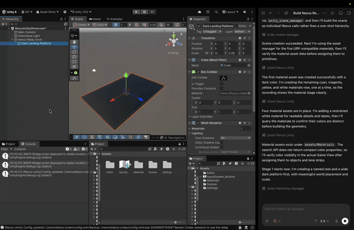

# Nexus Unity

[](https://github.com/ForkHorizon/NexusUnity/releases/tag/v1.6.2)
[](LICENSE.md)
[](package.json)

Nexus Unity is an open source Unity Editor automation package. It runs a local JSON-RPC server inside the Unity Editor and exposes scene, asset, code, log, test, inspection, and UI automation tools to trusted local developer workflows.

- Package id: `com.forkhorizon.nexus.unity`
- Version: `1.6.2`
- License: `MIT`
- Public repository: `https://github.com/ForkHorizon/NexusUnity.git`

## Status

Latest public release: `1.6.2`.

The public API is maintained for local Unity Editor automation workflows, while new tools and bridge improvements are tracked under `[Unreleased]` in `CHANGELOG.md` until the next tagged release.

## Screenshot / Demo

Click the preview below to watch the full 98-second Nexus Unity demo on YouTube.

[](https://www.youtube.com/watch?v=zapydBzRzkE)

**[Watch the full 98-second Nexus Unity demo on YouTube](https://www.youtube.com/watch?v=zapydBzRzkE)**

Open `Window > Nexus Unity` in the Unity Editor to use the server, integrations, resources, and settings tabs. The demo shows an AI agent using Nexus Unity to create a scene, inspect editor feedback, generate code, and iterate inside the Unity Editor.

## Requirements

- Unity `6000.0` or newer.
- Local machine access to the Unity Editor.
- Python 3 for MCP bridge integrations.

## Support matrix

| Environment | Transport |
| :--- | :--- |
| Unity 6000.x with `com.unity.pipeline` installed and a healthy Pipeline session | Preferred: Pipeline / persistent `unity mcp`. Runtime mode `auto` selects this. |
| Unity 6000.x without Pipeline, or Pipeline unhealthy | Compatibility: Legacy HTTP/MCP on loopback (default port 8081). |

`com.unity.pipeline` is **optional**. Nexus compiles and runs without it. Legacy HTTP is the minimal compatibility backend; it does not own Capture or command business logic. Removal of Legacy HTTP is not scheduled until Unity CLI 1.0 stable, non-experimental Pipeline, and one Nexus stable release after Pipeline-primary `auto`.

See [BENCHMARKS.md](BENCHMARKS.md) for public validation evidence and the ongoing performance benchmark ledger.

## Install

1. Open your Unity project.
2. Go to `Window > Package Manager`.
3. Click `+` and select `Add package from git URL...`.
4. Enter:

```text
https://github.com/ForkHorizon/NexusUnity.git
```

For reproducible installs, pin the public release tag:

```text
https://github.com/ForkHorizon/NexusUnity.git#v1.6.2
```

Nexus Unity does not declare Unity Project Auditor packages. Its lint tool always runs Nexus style and scene checks, and only includes Unity Project Auditor findings when the host project explicitly has compatible Project Auditor rules installed.

## Start The Server

1. Open `Window > Nexus Unity`.
2. Click `Start Server`.
3. Confirm the server is listening on the configured loopback port, usually:

```text
http://127.0.0.1:8081/
```

The server remembers that it was started and comes back after domain reloads and Unity restarts. Clicking `Stop` turns that off until you click `Start Server` again.

The server is intended for trusted local automation only. It validates loopback hosts and browser origins, requires the per-session `X-Nexus-Unity-Token` header generated by the Integrations setup flow, constrains file operations to the Unity project root, and limits request payload size.

## Editor Menu

Nexus Unity uses a single Unity menu entry: `Window > Nexus Unity`.

- `Server`: start, stop, restart, copy the local URL, and deploy the MCP bridge to the project root.
- `Integrations`: configure Codex, Claude Desktop, Claude Code, Gemini, Antigravity, Cursor, VS Code/Cline/Roo, Windsurf, or a generic MCP JSON client.
- `Resources`: open docs, API reference, changelog, and the package folder.
- `Settings`: choose how much Nexus Unity service logging is written to the Unity Console.

Diagnostic actions such as the UI test window, log verification, Codex link test, project audit, and API verification are available from the collapsed `Advanced / Diagnostics` block in `Resources`. The default tabs show only user-facing setup and server actions. Server and bridge blocks stay stacked vertically, while their action rows and the integration cards stretch and wrap cleanly across narrow and wide editor windows.

Console logging defaults to `Important`, which shows key lifecycle/setup messages plus warnings and errors. Use `Settings` or `Edit > Project Settings > Nexus Unity` to switch to `All` for full diagnostics or `Custom` to show info logs only for selected Nexus Unity categories.

## Public APIs

Nexus Unity supports two public surfaces:

- Raw HTTP JSON-RPC tools: unprefixed Unity method names returned by `list_tools`.
- MCP bridge tools: consolidated `unity_` manager tools optimized for AI clients, plus static docs through `resources/list` and `resources/read`.

PlayerPrefs deletion is guarded: deleting all entries requires `key: "all"` and `confirm: true`, and cannot be undone through Unity Undo.

C# script writes are guarded: `attach_script`, `write_file`, `write_files_batch`, and `unity_write_and_compile` require `confirm: true` when they write `.cs` files and trigger Unity compilation.

Raw `batch_execute` is capped at 50 requests and rejects nested `batch_execute` calls.

Fast-path health calls (`get_server_status`, `attach_existing_session`, `wait_for_asset_import_idle`, and `wait_for_editor_idle`) read one published readiness snapshot so they can run on the listener thread. The snapshot includes `ready`, `reason`, and `epoch` (`compile`, `reload`). A wait returns `Reloading` when a domain reload is armed; the bridge re-polls after reconnect.

Direct JSON-RPC example:

```bash
curl -s http://127.0.0.1:8081/ \
  -H 'Content-Type: application/json' \
  -H "X-Nexus-Unity-Token: $NEXUS_UNITY_AUTH_TOKEN" \
  -d '{"jsonrpc":"2.0","method":"get_server_status","params":{},"id":1}'
```

MCP clients should use the Python bridge:

```bash
python3 Packages/com.forkhorizon.nexus.unity/Editor/nexus_unity_bridge.py
```

The Unity window can also deploy the bridge to the project root for CLIs that prefer stable local paths. The deployment copies both `nexus_unity_bridge.py` and the required `nexus_bridge/` module.

## AI Client Setup

For Codex, Claude Desktop, Claude Code, Gemini, Antigravity, Cursor, VS Code/Cline/Roo, Windsurf, or compatible MCP clients, open `Window > Nexus Unity` and use the `Integrations` tab.

> **Updating:** after updating the package, run `Auto Setup` again for each client so the project-root bridge is redeployed, then reload the client. Avoid global `nexus-unity` entries that point at another project's bridge.

> **Claude Code vs. Claude Desktop:** these are different products with different config locations. The `Claude Code` card registers the `nexus-unity` server in a project-scoped `.mcp.json` at the Unity project root (using the `claude` CLI when it is on `PATH`, otherwise writing the file directly). If the CLI cannot remove an existing registration, setup skips its add command and writes `.mcp.json` directly instead. The `Claude Desktop` card writes the desktop app's `claude_desktop_config.json`. After running `Auto Setup` for Claude Code, run `/mcp` inside Claude Code (or restart it) to load the server.

Each integration card shows `Detected`, `Not found`, `Configured`, `Outdated`, or `Error` status and provides:

- `Auto Setup` when Nexus Unity can safely write or invoke the client configuration.
- `Copy Config` for manual setup.
- `Open Config` when the client uses a known config file path.

Nexus Unity generates configs from the resolved Python interpreter and the deployed `nexus_unity_bridge.py` path. If the configured token is missing or stale, the bridge reads the current token from the project's `Library/NexusUnityAuthToken.txt`, which it finds from any working directory. Antigravity uses the workspace-local `.agents/mcp_config.json`; its older global Gemini config location is not used. User/global config writes create a timestamped backup before modifying an existing file.

> **Windows / Linux:** The Python interpreter is resolved as `python3`, then `python`, then the Windows `py` launcher — make sure a Python 3 install is on `PATH`. CLI-based cards (Codex, Gemini, and the Claude Code CLI path) are detected with `where` on Windows and `which` on macOS/Linux, so the CLI must be on the `PATH` of the shell that launched Unity for `Auto Setup` to find it; otherwise use `Copy Config`.

`Outdated` means the client config points at a different Unity project, the project-root bridge has not been deployed, the auth token is missing or stale, or the deployed bridge version differs from the package bridge version. Run `Auto Setup`, then restart the affected MCP client session so it loads the current bridge.

Package path:

```json
{
  "mcpServers": {
    "nexus-unity": {
      "command": "python3",
      "args": ["Packages/com.forkhorizon.nexus.unity/Editor/nexus_unity_bridge.py"],
      "env": {
        "NEXUS_UNITY_AUTH_TOKEN": "<token from Integrations>"
      }
    }
  }
}
```

Root-deployed path:

```json
{
  "mcpServers": {
    "nexus-unity": {
      "command": "python3",
      "args": ["nexus_unity_bridge.py"],
      "env": {
        "NEXUS_UNITY_AUTH_TOKEN": "<token from Integrations>"
      }
    }
  }
}
```

## Key Tools

- `unity_write_and_compile`: write files, wait for Unity reload, and return compiler errors.
- `unity_scene_manager`: create, open, save, and list scenes, including raw-action aliases like `list_scenes`.
- `unity_hierarchy_manager`: create, rename, transform, destroy, duplicate, activate, parent, and batch-build GameObjects.
- `unity_component_manager`: add, inspect, update, and remove components.
- `unity_asset_manager`: search, import, refresh, and manage prefab assets.
- `unity_editor_controller`: play mode, menus, undo/redo, logs, editor state, asset refresh, and test-result polling.
- `unity_ui_automation`: query and operate Unity Editor UI Toolkit windows, including window rects for resize QA.
- `capture_game_view_screenshot` and `capture_inspector_screenshot`: structured image data with dimensions, base64 image bytes, and capture duration. Game View defaults to PNG and optionally accepts JPEG, quality, and downscale parameters.
- Experimental canonical commands `nexus.project_map`, `nexus.group_compile_errors`, and `nexus.capture_game_view` share one handler each and return one envelope (`ok`, `data`, `error`, `meta`). Capture defaults to JPEG at a 768 px longest edge, can crop to an object, and can frame a Scene View on a target (`nexus_look` is an alias). When `com.unity.pipeline` is installed they are also available as optional Pipeline CLI/MCP commands with that same envelope and the same parameter names and defaults. Legacy raw tools keep their existing JSON.
- Runtime mode defaults to `auto`: eligible Unity 6000 + Pipeline installs use Pipeline as primary and Legacy HTTP as fallback. Set Project Settings > Nexus Unity > Runtime to `legacy` to force HTTP. Legacy HTTP remains fully supported; removal is not scheduled until Unity CLI 1.0 stable, non-experimental Pipeline, and one Nexus stable release.

See `API_REFERENCE.MD` for the complete raw and MCP tool catalogs.

## Compatibility Notes

Version 1.6.2 keeps the public API backward-compatible while tightening schemas and documentation:

- Use `unity_write_and_compile` for code-edit workflows. Older references to `unity_apply_code_change` are outdated and should not be used for the public MCP bridge.
- `update_component` accepts the preferred `properties` object and the legacy `json_data` string form.
- `unity_scene_manager` accepts obvious aliases such as `list_scenes`, `create_scene`, `open_scene`, and `save_scene` while preserving action-specific required parameters; invalid manager actions now report the valid action names.
- `create_scene` accepts optional `path` and `open_if_exists` so agents can create or reopen a deterministic scene asset in one call.
- `create_primitive` accepts optional `name`, `parent_id`, `position`, `rotation`, `scale`, and `material_path`, which lets agents build visible non-origin objects without fragile follow-up calls.
- Vector3 fields accept either `{ "x": 0, "y": 1, "z": 0 }` or `[0, 1, 0]`.
- `set_transform` updates position, rotation, and scale.
- `get_game_object` returns `transform` and compact `components` data for cheap verify-after-write reads.
- Script writes require `confirm: true` before Unity compilation is triggered, then keep readiness not-ready until a compile that started after that write reloads, a failed compile settles, or the refresh compiles nothing. A write that arrives during an in-flight compile waits for the next compile. On macOS the refresh waits for Editor focus, up to 15 seconds.
- Play Mode transitions keep readiness probes busy until Unity finishes entering or exiting Play Mode.
- `create_material` accepts optional `path`, `base_color` / `color`, and `emission_color` so generated materials can be created inside a chosen project folder and made visibly distinct.
- `write_file` and `write_files_batch` create missing parent directories after path validation; `.cs` writes require `confirm: true`.
- `invoke_method.arguments` is an optional positional JSON array.
- `click_object_in_game` accepts a documented `instance_id` target and still supports hierarchy `path` lookup.
- Unity 6.x editor identity differences are handled internally: Nexus keeps JSON `instance_id` values stable while using Unity 6.4+ `EntityId` APIs when available and Unity 6.3-compatible instance ID APIs otherwise.
- `run_tests` returns `Submitted` only after Unity accepts the asynchronous request; use `get_test_results` for completed `TestResults*.xml` summaries or `unity_editor_controller` `run_tests_wait` to poll for completion without blocking Unity's main thread.
- `get_tool_usage_stats` reports in-memory raw tool counts, durations, and errors since Unity domain load without storing request payloads; `reset_tool_usage_stats` clears that state for scoped diagnostics. Both are also available through `unity_editor_controller`.
- `ui_get_window_rect`, `ui_set_window_rect`, and `ui_capture_window_snapshot` support automated layout checks for editor windows.

## Documentation

| Document | Purpose |
|---|---|
| `DOCUMENTATION.MD` | Architecture, setup, security, bridge deployment, and troubleshooting |
| `API_REFERENCE.MD` | Raw JSON-RPC and MCP bridge tool catalogs |
| `SECURITY.md` | Supported versions, vulnerability reporting, and local-only security policy |
| `CONTRIBUTING.md` | Contribution rules and validation expectations |
| `CODE_OF_CONDUCT.md` | Community behavior expectations |
| `RELEASE.md` | Public release checklist and smoke test |
| `CHANGELOG.md` | Public release history |
| `LICENSE.md` | MIT license text |

## Contributor Validation

Pull requests are checked by one GitHub check, `CI Scope`, posted by the CI Scope GitHub App; the checks run on a maintainer-owned Mac. Rules, limits and exceptions live on the CI Scope website (ci.forkhorizon.com) and the pinned gates in [ForkHorizon/ci-gates](https://github.com/ForkHorizon/ci-gates); this repository carries no CI workflow, gate config or linter settings. Unity compile and EditMode tests are not part of this check: run `scripts/prepush-validate.sh --integration` and the Unity EditMode suite locally before merging.

Contributor pull requests target `development`; `main` is release-only. Direct pushes to both are blocked and maintainers merge through GitHub. Review fork pull requests carefully before merge. Changes to existing tests, including moving them, need owner approval in CI Scope.

Editor security tests include JSON-RPC traversal checks for representative file and asset methods.

Contributors should author commits with an email address verified on their GitHub account, preferably the GitHub no-reply address from account email settings. Commits made with placeholder or unverified author emails can merge successfully but may not appear in GitHub contributor statistics. The repository `.mailmap` keeps local Git reports aligned for known historical identities, but it does not replace fixing local Git email configuration before future commits.

For quick local feedback, run `scripts/prepush-validate.sh --quick`, which is designed to finish in under a minute on normal contributor machines. It always runs static package validation and uses `NEXUS_UNITY_HOOK_LIVE=auto` by default: when the Unity server is reachable, the hook adds a short read-only live smoke check for the public raw tool catalog and key schemas; when the server is temporarily unreachable, it prints `NOTICE` and lets the push continue.

Live smoke behavior can be made explicit:

```bash
NEXUS_UNITY_HOOK_LIVE=off bash scripts/prepush-validate.sh --quick
NEXUS_UNITY_HOOK_LIVE=required bash scripts/prepush-validate.sh --quick
```

Full local integration validation is opt-in:

```bash
bash scripts/prepush-validate.sh --integration
```

Python bridge tests run without Unity:

```bash
python3 -m unittest discover -s Editor/tests -t Editor
```

Maintainers and agents can also run the optional focused tooling smoke:

```bash
python3 scripts/agent-tooling-smoke.py
```

For integration tests, open the Unity project, start the Nexus Unity server from `Window > Nexus Unity`, and set `NEXUS_UNITY_PROJECT_ROOT` if the package is not checked out under a Unity project.

## Development Versioning

The latest public release is `1.6.2`. Record user-visible work under `[Unreleased]` in `CHANGELOG.md` until the next tagged release.

When maintainers prepare a release, move the accumulated `[Unreleased]` entries to the new dated release section, update the visible version strings, then tag the release. Unity Package Manager and GitHub releases both use semantic `MAJOR.MINOR.PATCH` versions such as `1.6.2` and `v1.6.2`. Reserve patch bumps for urgent compatible hotfixes.

## Community

Please use GitHub Issues for reproducible bugs and focused feature requests. Security reports should follow `SECURITY.md` and use GitHub Security Advisories rather than public issues.

To support ongoing development, use the repository Sponsor button configured through GitHub Sponsors.

## Release Notes

The `1.6.2` patch fixes Claude Code and other Claude clients, which saw the nine manager tools (`unity_scene_manager`, `unity_hierarchy_manager`, `unity_component_manager`, `unity_search_manager`, `unity_asset_manager`, `unity_editor_controller`, `unity_ui_automation`, `unity_wait`, `unity_playerprefs_manager`) with no parameters in 1.6.1, so every call failed with `Invalid action: None`. `tools/list` now advertises one flat object schema per tool. Routing, validation, and the raw HTTP API are unchanged. After updating, restart the MCP client so it reloads the tool list.

The `1.6.1` release ships the former `1.7.0` development line. It adds canonical `nexus.project_map`, `nexus.group_compile_errors`, and `nexus.capture_game_view` commands with one `{ok, data, error, meta}` envelope, Capture V2 (JPEG by default, Scene View framing, target crop, file delivery), optional Unity Pipeline support with an `auto` runtime mode, and a single Editor readiness signal that does not report ready before a compile and domain reload finish. It also keeps AI clients connected: the server survives the package test run, the bridge finds the current token from any working directory, a stopped server gets a clear error, and the bridge no longer blocks on its own log output. After updating, run `Auto Setup` again for each client. See the `1.6.1` changelog entry for upgrade notes and known issues.

The `1.6.0` release hardens the local surface: `delete_asset` requires `confirm: true` and moves assets to the OS trash, `ProjectSettings/` and `Packages/` are write-protected across asset tools, `ValidatePath` resolves symlinks and junctions, type resolution is restricted to project and public Unity assemblies, and the auth token persists across Unity restarts. It also bounds UI hierarchy reads and fixes WebSocket blocking, PlayerPrefs listing hangs, and refresh callback leaks.

The `1.5.0` release relicenses Nexus Unity under MIT and hardens the public local-automation surface: every HTTP/WebSocket request now requires the session token; script writes and bulk PlayerPrefs deletion have explicit confirmation gates; raw batches are bounded; and readiness reports are safe during import and Play Mode transitions. It also improves cheap GameObject read-back, primitive validation, bridge resources, current MCP client setup, path-security coverage, test-result reporting, and cross-platform CLI launch reliability. See the complete, migration-relevant detail in the `1.5.0` changelog entry.

The `1.4.2` patch removes direct Unity Project Auditor dependencies to avoid clean-install Console spam, keeps Nexus lint checks available without Project Auditor rules, and tightens the Python MCP bridge schemas, routing types, and compile/test polling behavior.

The `1.4.1` patch adds the missing package folder `.meta` files (`docs/`, `docs/assets/`, `Editor/tests/`) so fresh installs no longer log "no meta file" warnings, and hardens the pre-push `.meta` validation to check the git-tracked tree and every folder.

The `1.4.0` release adds Claude Code project setup, improves Windows/Linux MCP client detection, refactors the Python bridge transport/logging layers, adds bridge unit tests and CI coverage, and updates external PR validation/replay guidance.

The `1.3.0` release improves integration drift detection, clarifies bridge redeploy restart guidance, and restores Unity 6.3 editor compilation while keeping Unity 6.4 object identity support.

The `1.2.0` release improves AI-driven scene building through manager aliases, richer primitive/material/transform actions, clearer invalid-action recovery, and stricter local/CI validation including checklist AI review and Unity package smoke tests.

The `1.1.2` hotfix repairs clean Unity Package Manager installs by keeping package-internal tests out of normal user compilation and declaring the required Input System dependency. If you installed `v1.1.0` or `v1.1.1`, update the pinned Git URL to `#v1.1.2` or newer and let Unity refresh PackageCache. If Unity keeps stale errors, close Unity, delete the old `Library/PackageCache/com.forkhorizon.nexus.unity@...` folder from the affected project, and reopen the project.

The `1.1.1` hotfix added a runtime assembly definition and removed Unity `.meta` files from the ignored `tools~/` folder.

The `1.1.0` release adds the public contribution validation gate, self-hosted AI documentation review, compact Nexus Unity editor UI, integration setup improvements, raw agent diagnostics, bridge polling actions, UI automation diagnostics, and console logging controls.

The original `1.0.0` open source release ships the Python bridge as the supported MCP bridge. Experimental native bridge artifacts are not included.
